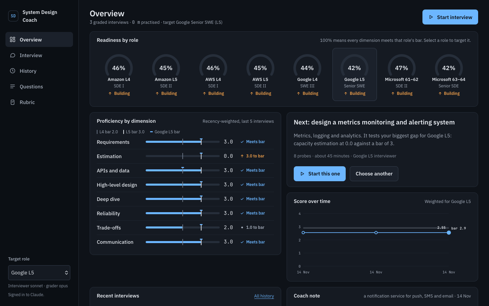

# System Design Coach

System Design Coach is a local web app for system design interview practice. Claude interviews you on the page and asks one probe at a time. Then Claude grades the transcript against a strict rubric. The dashboard shows your proficiency on eight dimensions and your readiness for eight roles at Amazon, AWS, Google and Microsoft. A zero-dependency Node server runs the app on `127.0.0.1`. For each interviewer turn and each grade, the server starts your own installed Claude Code CLI (`claude -p`) with no tools. An optional Mac app shows the coach in a window and adds on-device dictation.



This project is unofficial. It is not affiliated with Anthropic.

## Requirements

- Node 26 or later. The server uses only built-in modules, so you do not run `npm install`.
- [Claude Code](https://code.claude.com/docs/en/setup), signed in.
- For the Mac app: macOS 26 or later and the Xcode Command Line Tools, which give `swiftc`. Xcode includes them.

The browser version runs on macOS. The tests run on Linux in CI. Windows is untested.

## Install and first run

1. Clone this repository and open a terminal in it:

   ```sh
   git clone https://github.com/tim-jordan-1/system-design-coach.git
   cd system-design-coach
   ```

2. Install Claude Code. On macOS and Linux, run `curl -fsSL https://claude.ai/install.sh | bash`. You can also run `brew install --cask claude-code` or `npm install -g @anthropic-ai/claude-code`. On Windows, the PowerShell command is `irm https://claude.ai/install.ps1 | iex`. The [setup guide](https://code.claude.com/docs/en/setup) has the details.
3. Sign in. See [Authentication](#authentication).
4. Start the server with `node server.mjs` or `npm start`.
5. Open the link that the server prints. It looks like this: `System Design Coach on http://127.0.0.1:4319/?token=<key>`.

Open that exact link in your browser. The page needs the key. Each time the server starts, it makes a new key, so open the new link after a restart.

To use the Mac app instead, build it and open it:

```sh
sh mac/build.sh
```

The script puts `System Design Coach.app` in `~/Applications`. Open it from Spotlight, Launchpad or that folder. The app starts the server and opens the link for you. It runs its own copy of the code, so run `build.sh` again after you change the code. The app and a server in a terminal use the same interview files.

When you quit the app, its server stops. If you quit while Claude grades an interview, the grade stops too. Open the interview and select Grade it again. The server log is in `~/Library/Logs/System Design Coach.log`.

## Authentication

The coach uses the login of your own Claude Code installation. It never sees, stores or sends your credentials. Sign-in happens only in Claude Code's own flow.

To sign in, run one of these commands in a terminal:

- `claude auth login` signs in with a Claude subscription. This is the default.
- `claude auth login --console` signs in with Anthropic Console, which bills API usage.

Run `claude auth status` to see the state of the login. See the [authentication guide](https://code.claude.com/docs/en/authentication) for more.

In the Mac app, the rail shows whether you are signed in. It offers "Sign in with a Claude plan", which runs `claude auth login --claudeai` in Terminal. It also offers "Use an API key (Console)", which runs `claude auth login --console`. When the login ends within 3 days, the rail shows how to renew it.

Things to know before you choose:

- You use your own Anthropic account, with its limits and its billing. Each interviewer reply and each grade counts as use of that account.
- An API key through Anthropic Console is the path that Anthropic's terms clearly allow for scripted use. Anthropic's [Consumer Terms](https://www.anthropic.com/legal/consumer-terms) restrict automated or scripted access except through an API key or where Anthropic explicitly permits it.
- Anthropic's [legal and compliance page](https://code.claude.com/docs/en/legal-and-compliance) says that subscription login is for people who buy a Claude plan and for ordinary use of Claude Code. It says that third-party developers must not offer Claude.ai login in their apps or route requests through plan credentials for their users. It also says that this does not stop you from signing in to the unmodified Claude Code program with your own subscription.
- If you use a Claude plan, you are responsible for making sure that your use follows Anthropic's terms. This README is not legal advice.
- The [headless documentation](https://code.claude.com/docs/en/headless) says that `--bare` will become the default for `claude -p` in a future release, and that bare mode never reads OAuth credentials. A future Claude Code release can therefore require an API key for this app.

Anthropic's pages above were current on 2026-11-14.

## Run an interview

1. Select your target role in the left rail, or select a gauge on the Overview page.
2. Open Interview. Select a question, the role to interview for, and a length of 5, 8 or 12 probes.
3. Type your answers in the chat box. To send, press Cmd+Enter on a Mac or Ctrl+Enter on other systems.
4. Keep your requirements, estimates and schema in Design notes. Claude reads the notes with every answer, and the grader reads them too.
5. Wait for the last probe. The interviewer then closes the interview, and grading starts. To stop early, select End and grade. To stop without a grade, select Discard.
6. Read the scorecard. Each score shows the quotes that support it, what an L5 answer adds, and a drill.

## Set your background

On the Start interview page, you can fill in "Your background". This is optional. It tells the interviewer and the grader what you already know, so the questions and the grade fit your level. The coach saves the text in `~/.system-design-coach/profile.json` and adds it to the interviewer prompt and the grader prompt. The code contains no background for any person.

## Dictate an answer

In the Mac app, you can speak your answers. Dictation turns your speech into text on the Mac. No audio leaves the Mac, and the app saves no audio.

1. Put the caret where the words go in the answer box.
2. Select Dictate, or press Cmd+D. The first time, macOS asks for access to the microphone. Select Allow.
3. Speak your answer. The words appear in the box as you speak, and the meter shows that the microphone hears you.
4. Select Stop, or press Cmd+D or Esc.
5. Read the text, and fix each word that the transcriber heard wrong. Claude grades the exact words in the box.
6. Press Cmd+Enter to send. If you send while you dictate, the last words go in first.

The app fixes system design terms that speech recognition often gets wrong, for example "cash" for cache and "page 99" for p99. The rules are in `public/dictation.mjs`. If you add a rule, also add a sentence that the rule must not change to `test/dictation.test.mjs`.

If microphone access is off, the coach shows a button that opens System Settings. Turn on System Design Coach in Privacy & Security > Microphone, then select Dictate again. After you rebuild the app, macOS can ask for the microphone again, because the build signs the app ad hoc.

In a browser, the coach has no Dictate button. Use macOS Dictation instead: in the browser's Edit menu, select Start Dictation.

To make sure that dictation works without a microphone, run this command on a Mac:

```sh
sh mac/check-dictation.sh
```

The benchmark behind the choice of speech engine is in [docs/dictation-engine.md](docs/dictation-engine.md).

## How the grading stays strict

The grader is Claude with the `opus` model at high effort. After the grader answers, the code applies these rules:

- A score above 0 needs a quote of your exact words. The code makes sure that each quote occurs in your answers or notes. A dimension with no quote that the code can find scores 0.
- Sometimes the interviewer names the technique or the problem before you do. Then that dimension scores 2 at most, which is the L4 bar.
- Fixed formulas give the verdict and the readiness, not the model. The Rubric page shows the formulas.

The interviewer is Claude with the `sonnet` model at low effort. It gets a budget of probes and a list of the dimensions that it did not test yet. It does not give hints unless you ask for one.

Each call to Claude runs in isolation. It has no tools, no MCP servers, no user settings, no hooks, no CLAUDE.md files, and no saved session history. Because the calls have no tools, text in your answers or notes cannot make Claude run anything.

## Configuration

The server reads these environment variables. Each one has a default.

| Variable | Default | What it sets |
|---|---|---|
| `SDC_PORT` | `4319` | The port. Use `0` for a free port. |
| `SDC_HOME` | `~/.system-design-coach` | The folder for interview files. |
| `SDC_CLAUDE` | `claude` | The `claude` program. Tests set it to a fake. |
| `SDC_INTERVIEWER_MODEL` | `sonnet` | The interviewer model. |
| `SDC_GRADER_MODEL` | `opus` | The grader model. |
| `SDC_STOP_WITH_STDIN` | not set | If set, the server stops when its stdin closes. The Mac app sets it. |

## Where your data goes

- Your answers and notes go to Anthropic through your own Claude Code, and nowhere else.
- Your data stays in `~/.system-design-coach`. Each interview is one JSON file in `sessions/`. Delete and Discard move a file to `trash/`. They do not remove the file. Only your user can read these folders and files (mode 0700 for folders, 0600 for files).
- The app has no telemetry, no analytics and no accounts.
- The page loads its two fonts from Google Fonts. Each time that the page loads, Google sees your IP address.
- Audio never leaves the Mac. The app does not save it.

The server answers only requests whose Host is `127.0.0.1` or `localhost` on its port. Every `/api` call needs the key from the link. The Mac app's web view shows only the local coach page, and it opens other links in your default browser. See [SECURITY.md](SECURITY.md) for the threat model.

## Change the rubric, the roles or the questions

- `lib/rubric.mjs` holds the scale, the eight dimensions with their level anchors, the grading rules, and the eight roles with their bars and weights.
- `lib/questions.mjs` holds the question bank. Each question has hidden notes for the interviewer (`crux`) and the dimensions that it tests hardest (`stress`).
- `lib/prompts.mjs` holds the interviewer prompt and the grader prompt.

The bars and the weights of each role come from [docs/company-bars.md](docs/company-bars.md). The level labels of the companies do not line up. For example, Amazon L5 is on the same rung as Google L4.

## Run the tests

```sh
npm test
```

This runs `node --test test/`. The tests do not use your Claude quota. They use `test/fixtures/fake-claude.mjs` in place of the real program. The files `test/fixtures/turn-interviewer.jsonl` and `test/fixtures/turn-grader.jsonl` are real output from `claude`, so the tests also catch a change in its output format.

## Calibration

The calibration script grades three red-team transcripts with the real grader. The transcripts contain weak answers, technology names with no mechanism, and a prompt injection in the answers and notes. Each transcript must score low.

```sh
node calibrate.mjs --yes
```

This command makes three grader calls, so it uses a part of your own Claude quota. Run it after you change the rubric, the grader prompt or the grader model. On 2026-10-31, all three transcripts passed.

## Uninstall

Delete `System Design Coach.app` from `~/Applications`. Then delete the `~/.system-design-coach` folder, which holds your interviews and your background. If you no longer need the cloned repository, delete it too.

## License

[MIT](LICENSE)
